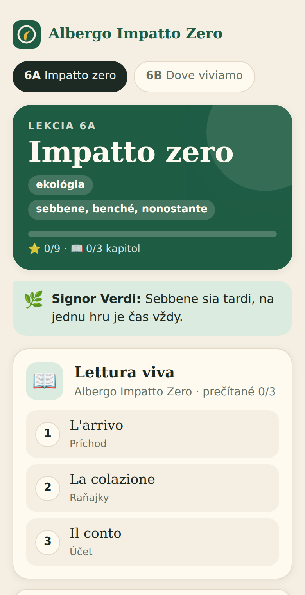
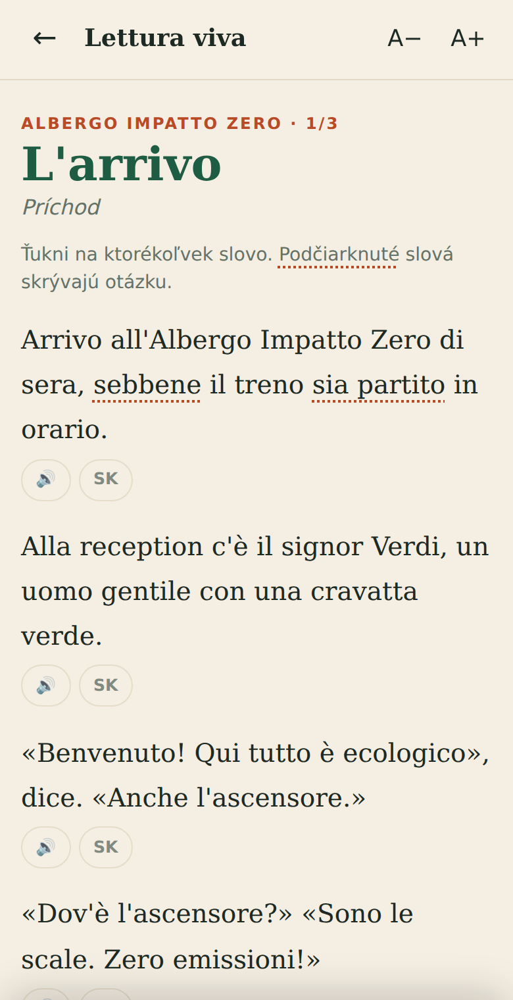
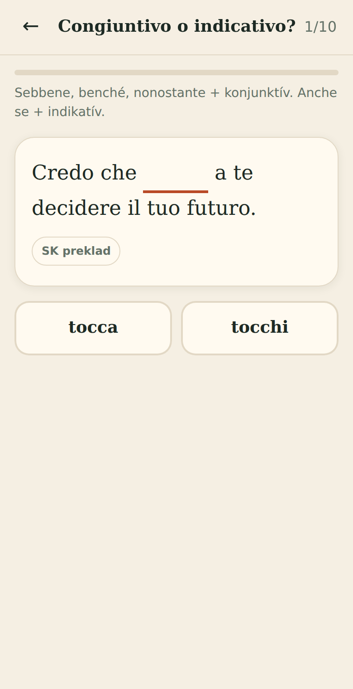

# Albergo Impatto Zero · Taliančina hrou

[](https://github.com/jurzon/taliancina/actions/workflows/validate.yml)

Taliančina pre slovensky hovoriacich žiakov: príbehy, v ktorých sa dá ťuknúť na každé slovo, a minihry k lekciám z učebnice DIECI. Funguje v prehliadači na mobile aj počítači, bez inštalácie a bez registrácie.

### ▶ Hrať: https://jurzon.github.io/taliancina/

<p>
  
  
  
</p>

## Lekcie

| Lekcia | Príbeh | Slovná zásoba a gramatika |
|---|---|---|
| **6A** Impatto zero | Albergo Impatto Zero | ekológia, *sebbene / benché / nonostante* + konjunktív |
| **6B** Dove viviamo | Il sogno del signor Verdi | mesto, vidiek, ostrov, *periodo ipotetico* |

## Hry

- 📖 **Lettura viva**: príbeh v kapitolách. Ťuknutím na slovo sa ukáže preklad, podčiarknuté slová skrývajú otázku a na konci kapitoly sú otázky *vero o falso*.
- ✨ **Costellazioni**: v strede je slovo a okolo sa vynárajú ďalšie, treba chytiť tie, ktoré s ním tvoria ustálené spojenie.
- 🚦 **Congiuntivo o indicativo?**: karty s medzerou a vysvetlením, prečo je správna práve táto možnosť.
- 🧩 **Costruisci la frase**: skladanie talianskej vety z dlaždíc.

Engine má aj ďalšie minihry (odkaz na záznamníku s mapou, triedenie, páry, jazero, hláskovanie), ktoré sa dajú zapnúť v ktorejkoľvek lekcii, pozri [docs/lekcia.md](docs/lekcia.md).

Pokrok (hviezdy, prečítané kapitoly, séria dní) sa ukladá iba v prehliadači, appka nič neodosiela.

## Pre vývojárov

Čisté HTML, CSS a JavaScript bez buildu a bez závislostí.

```sh
python3 -m http.server 8000      # spustiť lokálne na http://localhost:8000
node tools/validate.mjs          # skontrolovať obsah lekcií
```

| Priečinok | Obsah |
|---|---|
| `js/` | engine, spoločný s repozitárom [anglictina](https://github.com/jurzon/anglictina) (zmeny treba preniesť aj tam) |
| `js/games/` | minihry; register je v `js/games/index.js` |
| `data/config.js` | jazyk, značka, maskot, texty hier |
| `data/index.js`, `data/lezione*.js` | zoznam lekcií a ich obsah |
| `tools/validate.mjs` | kontrola obsahu (beží aj automaticky na GitHube pri každom pushi) |

**Nová lekcia:** pozri [docs/lekcia.md](docs/lekcia.md).

## Autor a licencia

Juraj Zonnenschein · jurzon@seznam.cz

Pre školy a nekomerčné učenie zadarmo, pozri [LICENSE](LICENSE).
